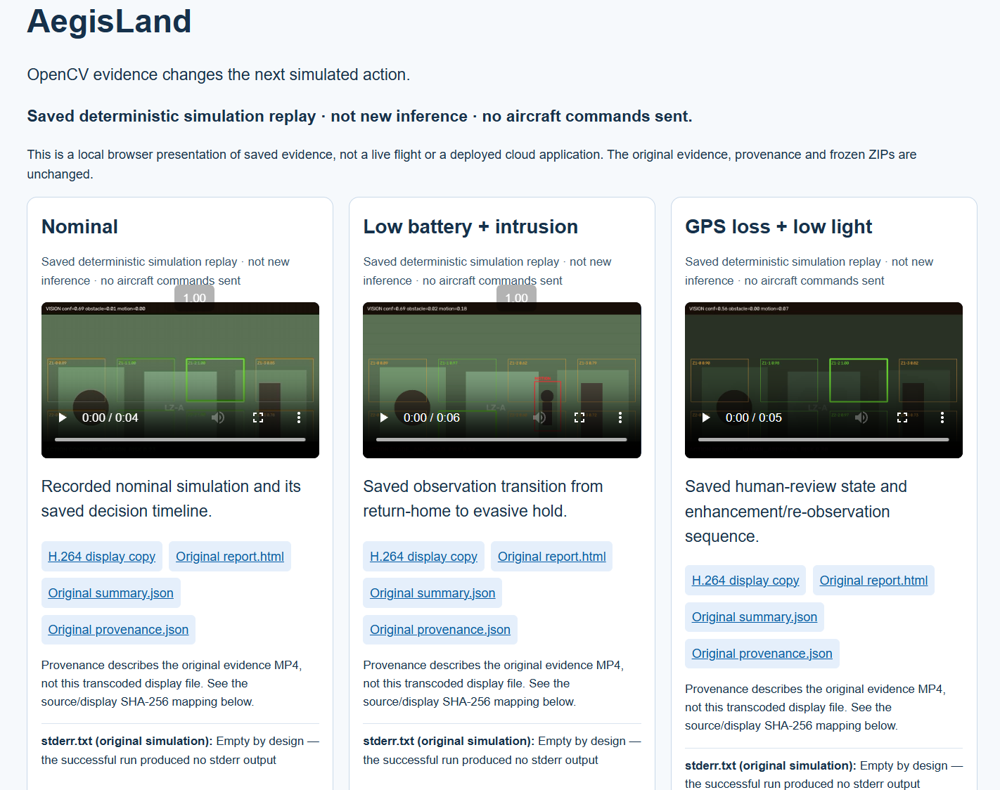
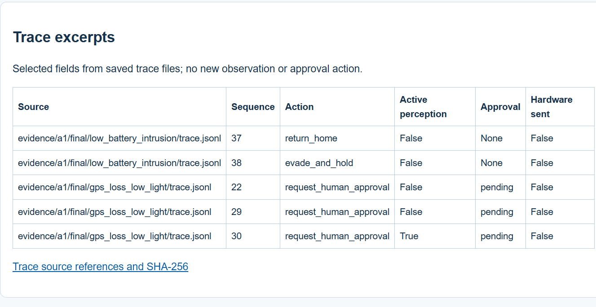
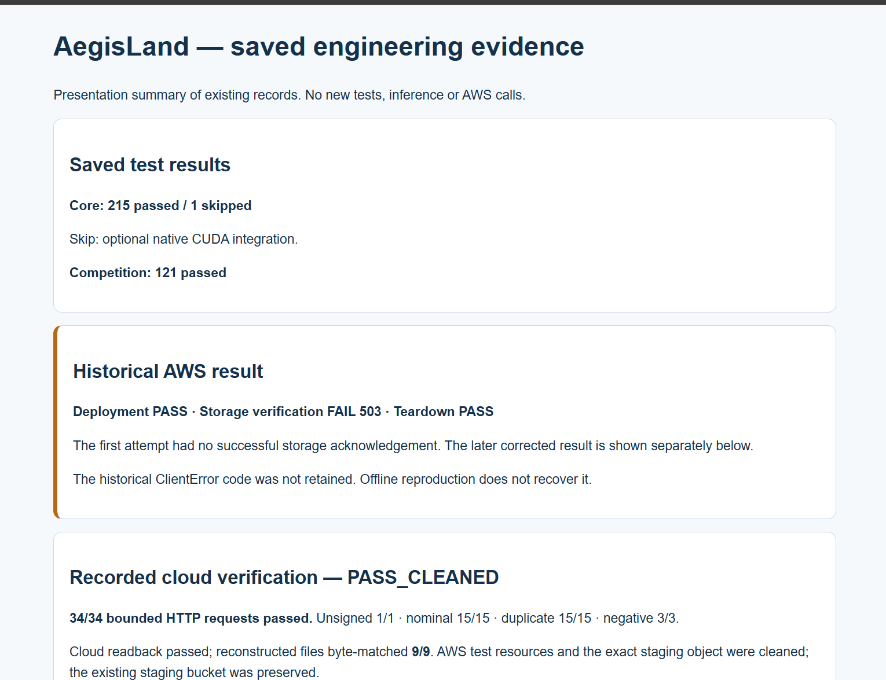
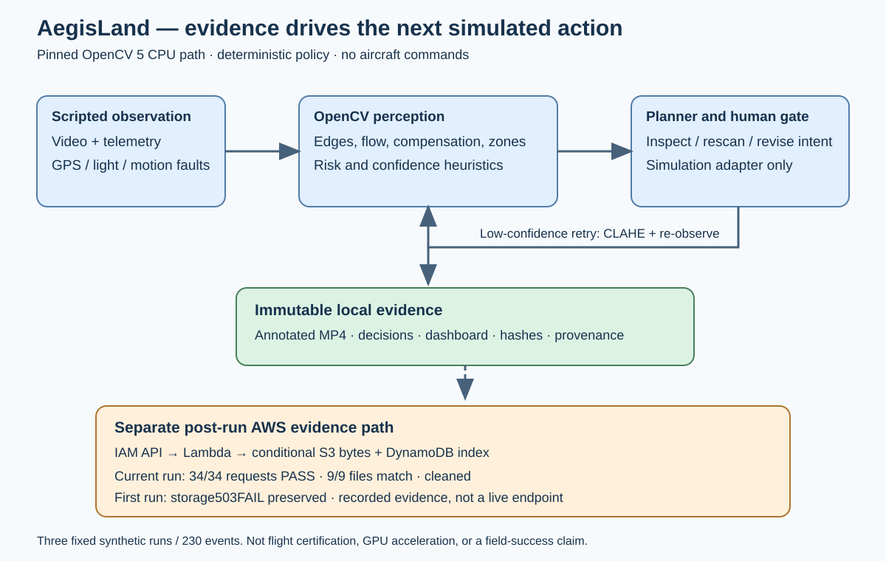

<div align="center">

# AegisLand

### Visual evidence that changes the next simulated landing action.

**OpenCV AI Competition 2026 · Agentic Vision**

<p>
  <a href="https://github.com/Cyberchopin/aegisland-opencv-2026/actions/workflows/baseline.yml"></a>
  <a href="core-pin.json"></a>
  
  <a href="#verified-results"></a>
  <a href="docs/AWS_PHASE_B_VERIFIED_20261025.md"></a>
  
</p>

**[Demo](#demo)** · **[Architecture](#architecture)** · **[Verified results](#verified-results)** · **[Run locally](#run-locally)** · **[Technical report](submission/entry-20261024/TECHNICAL_REPORT.md)** · **[Judge entry](submission/entry-20261024/START_HERE.md)**


<sub>Owner-provided AI concept artwork. The demonstrated system below uses synthetic simulation; this illustration is not flight footage or evaluation evidence.</sub>

</div>

---

AegisLand connects **OpenCV observations → risk assessment → the next simulated action**. Its deterministic planner can reconsider a scene, request an enhanced observation, revise an intent, or route a decision to human review. Every retained decision comes with an inspectable trace.

> **Demonstration scope:** saved deterministic simulation replay, **not new inference**. No aircraft hardware commands are sent. The verified cloud test was cleaned up; the screenshots do not represent a currently running cloud endpoint.

| 👁️ Measure | 🔄 Reconsider | 🧾 Preserve |
| --- | --- | --- |
| OpenCV 5 edges, texture, optical flow, motion compensation and landing-zone measurements | Hazard-driven intent changes, CLAHE enhancement and re-observation, policy-defined human review | Annotated video, decision traces, provenance hashes and separately verified cloud storage |

## Demo

Three recorded scenarios show the same perception–decision loop under different conditions.



*Owner-captured presentation of saved synthetic runs. The local page provides H.264 playback and links to each original report, summary and provenance record.*

| Scenario | Saved frames / events | What to inspect | H.264 replay |
| --- | ---: | --- | --- |
| **Nominal** | 60 | Baseline simulated mission and decision timeline | [View / download](submission/devpost-final-materials-20261024/media/nominal.h264.mp4) |
| **Low battery + intrusion** | 90 | Intent changes from `return_home` at sequence 37 to `evade_and_hold` at 38 | [View / download](submission/devpost-final-materials-20261024/media/low_battery_intrusion.h264.mp4) |
| **GPS loss + low light** | 80 | Pending human approval and a later enhancement/re-observation step | [View / download](submission/devpost-final-materials-20261024/media/gps_loss_low_light.h264.mp4) |

**The agentic behavior is in the transition:** a visual measurement changes the next simulated action or observation. The planner does not depend on an LLM. Human review applies where policy requires it; critical reserve can require emergency action without waiting for approval.

<details>
<summary><strong>📸 Inspect the saved decision traces and engineering results</strong></summary>

### Decisions tied to observations



The screenshot selects fields from existing traces; it does not show a new observation or a live approval action. [Trace references and hashes](submission/devpost-final-materials-20261024/visuals/trace_examples.json).

### Engineering evidence with the first failure retained



The first `503 storage_unverified` failure is preserved alongside the later successful bounded run. The full result is linked below; this screenshot is a presentation of saved records.

</details>

## Architecture



**Local loop:** scripted video and telemetry → OpenCV perception → navigation/risk assessment → deterministic planner → simulation adapter. Low confidence can trigger CLAHE and another OpenCV observation when reserve permits.

**Separate evidence path:** signed packets → IAM-authenticated API → Arm64 Lambda → conditional S3 object write → DynamoDB index → checksum-bound acknowledgement. Object bytes and a strongly consistent index read must agree before storage is acknowledged. Cloud responses do not change the simulation's safety decisions.

## Verified results

| Evidence | Recorded result | Inspect |
| --- | --- | --- |
| OpenCV simulation | **3 scenarios · 230 matching decoded frames and trace events** | [Original evidence](evidence/a1/final/) |
| Competition suite | **121 passed** | [Validation matrix](docs/candidates/OFFLINE_VALIDATION_MATRIX.md) |
| Full core suite | **215 passed · 1 skipped** — opt-in native CUDA integration | [Saved validation matrix](docs/candidates/OFFLINE_VALIDATION_MATRIX.md) |
| Bounded AWS requests | **34/34 passed** · no application retries or redirects | [Sanitized live-test report](docs/AWS_PHASE_B_VERIFIED_20261025.md) |
| Cloud readback | **15 S3 objects + 15 strongly consistent DynamoDB items** | [Public verification summary](submission/devpost-final-materials-20261024/verification/CLOUD_VERIFICATION_20261025.json) |
| File reconstruction | **9/9 byte-matched** the frozen local originals and SHA-256 values | [Nine file hashes](submission/devpost-final-materials-20261024/verification/CLOUD_VERIFICATION_20261025.json) |
| Cleanup | **PASS_CLEANED** — test resources and exact staging object removed | [Cleanup scope and limits](docs/AWS_PHASE_B_VERIFIED_20261025.md) |

Test counts are **saved results**; opening this README or the presentation does not rerun them. The core suite was not rerun during final packaging. MP4 playback at 15 FPS is not processing throughput.

The 34-request cloud run comprised **unsigned 1/1 · nominal 15/15 · duplicate 15/15 · negative 3/3**. The existing staging bucket was preserved. Actual charges remain unknown; the spending target was not a hard cap, and service-managed KMS or possible PITR records can persist.

**The first failure stays in the record.** The earlier live attempt was deployment PASS / storage FAIL 503 / teardown PASS. Its exact historical AWS error code remains unknown. The [original failure report](docs/AWS_PHASE_B_RESULT.md) and historical evaluations are unchanged; later success does not rewrite that failure.

## Run locally

### 1. Open the saved replay

From the repository root, with the prepared environment:

```bash
.venv/bin/python -m http.server 8081 --bind 127.0.0.1 \
  --directory submission/devpost-final-materials-20261024
```

Open **http://127.0.0.1:8081/**. The homepage directly embeds three H.264 video players and their evidence links. It serves existing files, makes no AWS calls and runs no new inference. This loopback address is not a public judge endpoint.

### 2. Reproduce a local simulation

The core is [Cyberchopin/aegisland-agentic-vision](https://github.com/Cyberchopin/aegisland-agentic-vision), pinned to `eda23d3ea646e8943287703c07a91e9a3b2909fb` in [core-pin.json](core-pin.json). Core source is not duplicated here. Initial source/dependency acquisition needs network and access; see the [integration plan](docs/INTEGRATION_PLAN.md).

With a clean pinned `.baseline/core` and the prepared `.venv`, choose an output directory that does not already exist:

```bash
.venv/bin/python scripts/competition_demo.py \
  --core .baseline/core --scenario gps_loss_low_light --output runs/judge-gps
```

The wrapper checks OpenCV 5, the core pin and clean tree; disables the original cloud endpoint; validates decoded video/trace counts; and refuses to overwrite outputs.

```bash
# Offline competition checks; this is not the full core suite.
.venv/bin/python -m pytest -q tests
.venv/bin/python -m ruff check cloud scripts tests
```

<details>
<summary><strong>Prepare an evidence packet plan locally</strong></summary>

```bash
.venv/bin/python scripts/evidence_cloud.py \
  --evidence evidence/a1/final/nominal --output runs/cloud-plan-nominal
```

This prepares a local plan without constructing a cloud transport. Do not use `--upload`, deployment or quota scripts without new authorization. The completed live procedure used one uploader and `attempts=1`; the general uploader's three-attempt default is not that procedure.

</details>

## Submission guide

| Start here | Purpose |
| --- | --- |
| [Judge entry](submission/entry-20261024/START_HERE.md) | Demonstration, current report and reproduction links |
| [Final handoff](FINAL_SUBMISSION_HANDOFF.md) | Verified results and remaining owner actions |
| [Technical report](submission/entry-20261024/TECHNICAL_REPORT.md) | OpenCV workload, architecture, evaluation and limits |
| [Submission materials](submission/devpost-final-materials-20261024/README_先读我.md) | Chinese operating guide, narration, screenshots and copy-paste content |
| [2:55 recording plan](submission/devpost-final-materials-20261024/03_分秒镜头表.md) | Timed shots for an under-three-minute video |
| [Devpost field copy](submission/devpost-final-materials-20261024/devpost/00_字段对应表.md) | English text mapped to common form fields |
| [Final checklist](submission/devpost-final-materials-20261024/05_最终提交检查表.md) | Access, video, eligibility and owner submission checks |

Video capture/upload, eligibility and rights checks, judge/source access, a real demonstration arrangement and Devpost submission remain owner tasks. The tested API has been deleted.

<details>
<summary><strong>Scope, reproducibility and artifact boundaries</strong></summary>

- The demo uses fixed synthetic scenes and heuristic perception. Commands do not drive a flight-dynamics model; no aircraft hardware commands are sent. The core retains its safety policy, GPS-denied behavior and PX4 shadow supervision.
- CPU profiling and exact replay checks are available. Historical standalone CUDA results are separate from the CPU demonstration. No GPU speedup, real-time capability, field success rate or production-flight safety is claimed.
- The frozen source ZIP and materials ZIP remain unchanged historical snapshots. A ZIP's SHA-256 identifies that artifact, not this repository's current tree or a Git commit.
- Historical build/review scripts depend on separately retained approval attachments; a reduced clone cannot regenerate every historical ZIP. See [artifact boundaries](submission/entry-20261024/CLOUD_STATUS.md#repository-and-attachment-boundaries).
- Core reuse, team contribution and distribution rights need owner confirmation. This README grants no new license.
- [README visual provenance](docs/assets/readme/ASSETS.md) distinguishes concept artwork from owner-captured screenshots. Original evidence videos, provenance and historical evaluations are unchanged.

No AWS call, deployment, merge or Devpost submission is authorized by these instructions or candidate files.

</details>
