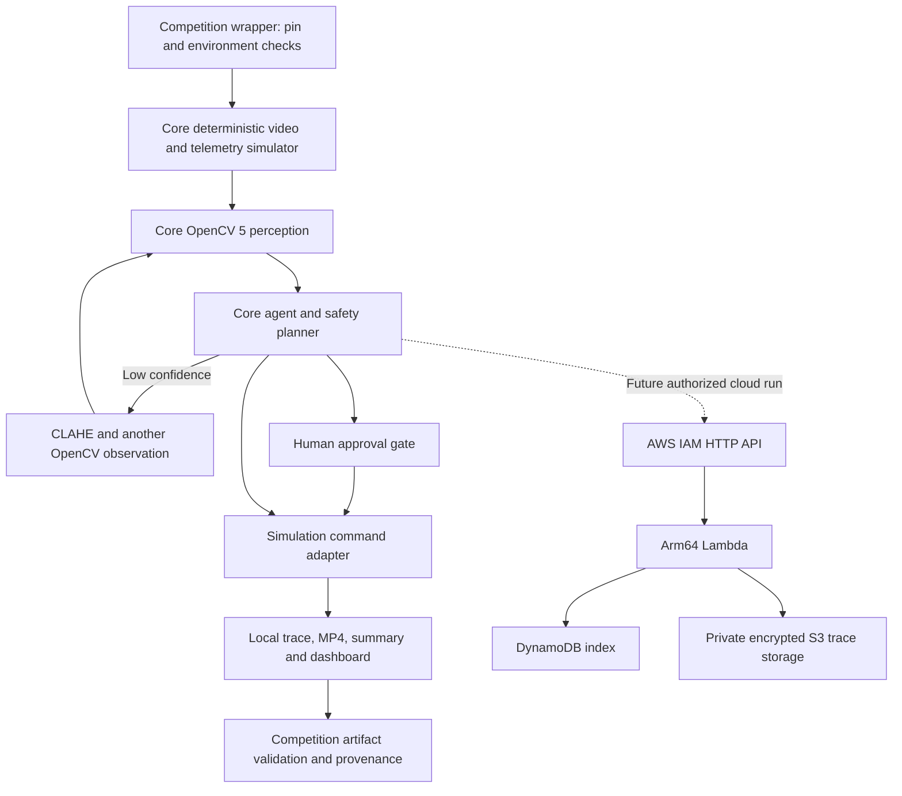

# A1 integration plan

Use the core as a pinned external checkout. The competition repository owns the launch wrapper, evidence packaging, judge instructions and submission documents. Perception, planning, approval, command execution and safety thresholds remain in the core.

The pin is `eda23d3ea646e8943287703c07a91e9a3b2909fb` in [core-pin.json](../core-pin.json). This was the core's remote `main` at inspection on October 21, 2026. The competition starting commit is `4ba11c1781e51b6822a8bc329080fe903258fba4`; A1 work is on `codex-a/stage-a1-baseline`.

## Reproduce locally

Use Python 3.12 on Linux with OpenCV's MP4 codec dependencies available. Run from the competition repository root:

```bash
git clone https://github.com/Cyberchopin/aegisland-agentic-vision.git .baseline/core
git -C .baseline/core checkout --detach eda23d3ea646e8943287703c07a91e9a3b2909fb
python3 -m venv .venv
.venv/bin/python -m pip install -r .baseline/core/requirements-lock.txt
.venv/bin/python -m pip check
.venv/bin/python -m pytest -q tests
.venv/bin/python scripts/competition_demo.py \
  --core .baseline/core --scenario gps_loss_low_light --output runs/judge-gps
```

Choose a fresh output directory for every run. The clone and virtual environment are ignored. The wrapper loads the core through a child-process `PYTHONPATH`, so installation does not write package metadata into the checkout. It rejects a wrong commit or a dirty tree, including untracked files; writes outside the core; disables `AEGISLAND_TRACE_ENDPOINT`; and verifies the imported module path and OpenCV major version. This entry point intentionally exercises the local simulation. A future cloud verification command must be separately authorized and retain HTTP acknowledgements and storage receipts.

Generated files:

| File | Purpose |
| --- | --- |
| `annotated.mp4` | Actual OpenCV rendering of the synthetic scenario |
| `trace.jsonl` | Telemetry, visual evidence, decisions, reasons and simulated commands |
| `summary.json`, `report.html` | Core-generated summary and evidence dashboard |
| `opencv-build.txt` | Imported package versions, module location and OpenCV build configuration |
| `stdout.txt`, `stderr.txt` | Exact core CLI output |
| `provenance.json` | Command, environment overrides, commits, dirty status, source hash, artifact hashes and validation |

The wrapper decodes the video and compares its length with the trace and summary. It also checks event sequencing, evidence identities, decision reasons and `hardware_command_sent == false`. These checks establish artifact integrity, not task success or flight safety. UUIDs, timings and codec output may differ between runs. Compare decisions and evidence fields separately from wall-clock measurements.

To inspect the dashboard, open the generated `report.html` locally. For browser video playback use a loopback server, for example `.venv/bin/python -m http.server 8080 --bind 127.0.0.1 --directory runs/judge-gps`. Do not expose this development server publicly.

## Verify the existing core contract

The core tests include subprocess CLI checks, so export its source path to their child processes:

```bash
PYTHONPATH="$PWD/.baseline/core/src" .venv/bin/python -m pytest \
  -c .baseline/core/pyproject.toml \
  .baseline/core/tests/test_agent_loop.py \
  .baseline/core/tests/test_planner.py \
  .baseline/core/tests/test_approval.py \
  .baseline/core/tests/test_commands.py \
  .baseline/core/tests/test_gps_denied.py \
  .baseline/core/tests/test_px4_shadow_policy.py \
  .baseline/core/tests/test_px4_supervisor.py \
  .baseline/core/tests/test_profiling.py
.venv/bin/ruff check scripts tests
```

`scripts/record_command.py DESTINATION COMMAND ...` stores argv, working directory, UTC times, exit code, stdout and stderr in a new JSON file. It returns the command's exit code. Use it for each submission verification command; do not put credentials in argv or logs.

## Component boundaries



The dashed AWS path describes infrastructure in the core. A1 did not execute it. The cloud is evidence storage, not flight control. The generated video is synthetic and the actions do not feed back into a physical drone or a flight dynamics model.

## Updating and rollback

Use an explicit pin-update change after reviewing the upstream diff. Change `core-pin.json` and the CI checkout ref together, rerun targeted tests and fresh demonstrations, then compare action transitions and failure handling. Never patch a vendored policy or silently track `main`. Reverting the competition changes removes the integration without modifying core source.

The new CI workflow reproduces a local demo and uploads evidence. It has not been pushed or executed on GitHub. It assumes the core remains accessible to the runner; private access needs an approved credential arrangement. Python packages are pinned by the core lock; action tags and runner image updates remain reproducibility limits. Archive wheel hashes and pin action SHAs before the final release if time permits.

## Next milestones

1. Resolve cloud delivery evidence first: prepare a backend contract/failure test patch for owner review, including HTTP status handling and recovery from partial storage writes. Make any core changes in a separate approved scope; keep the policy untouched. Only after explicit deployment/cost authorization, verify a signed upload and matching DynamoDB/S3 receipts with budget controls.
2. Build a short judge narrative from existing evidence: nominal operation, intrusion-driven evasion, low-light rescan and human gate. Add a measured failure case and explain critical-battery exceptions.
3. Finish the technical report, judge access and a video under five minutes. Confirm rights, registration, award opt-in and submission fields with the owner.

Freeze engineering by October 25 where possible. Reserve October 26 for upload checks and an earlier submission buffer; leave October 27 for the owner's midterm. New CUDA work and COOL benchmarking are outside A1.
