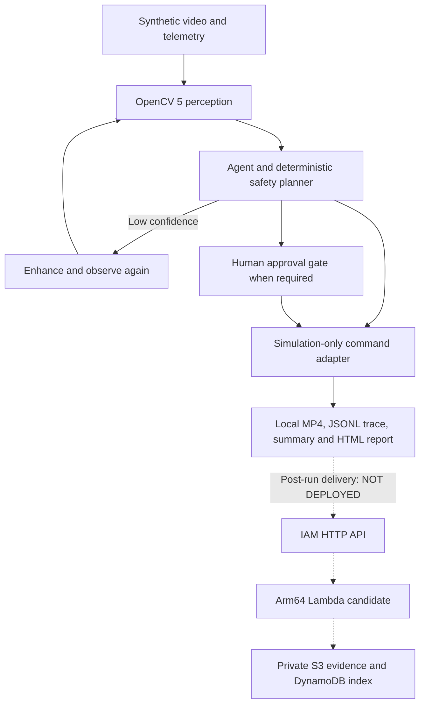

# AegisLand: OpenCV evidence that changes the next simulated landing action

Technical report for owner review · OpenCV AI Competition 2026 · October 22, 2026

**Status:** the local application, evidence generation and mocked cloud reliability checks work. The AWS component has not been deployed or exercised against actual object/table storage. This report does not claim a complete eligible submission while that requirement remains unmet.

## Problem and intended use

A landing supervisor must respond when battery reserve, navigation or visual confidence deteriorates. Returning home may be unavailable; a previously clear area may become occupied; a dark image may justify another observation instead of immediate action. A useful prototype should make these changes observable and preserve why each action was chosen.

AegisLand is a research prototype for robotics developers and operators evaluating that decision process. OpenCV measurements feed a deterministic agent and planner. The agent can rescan, change its simulated flight intent or route an ambiguous action to human review. Its command adapter sends no hardware commands. The intended operational benefit remains a hypothesis: no user study, field trial, production-flight validation or certification is claimed.

## Implementation and reuse

The core repository is pinned to `eda23d3ea646e8943287703c07a91e9a3b2909fb`. It supplies perception, synthetic scenarios, policy, approval handling, simulated execution, traces and reporting, with additional GPS-denied/PX4 shadow and profiling tools. Competition work does not change its safety policy.

The competition repository adds a pinned launch wrapper, artifact checks and provenance, a separate evidence delivery protocol/backend, failure-injection tests, deployment gates and judge materials. The competition branch is `codex-a/stage-a1-baseline`, based on `4ba11c1781e51b6822a8bc329080fe903258fba4`. The additions are still uncommitted; the review package records individual file hashes rather than pretending the base commit contains them.

Local runs used Python 3.12.3, NumPy 2.5.2 and `opencv-python==5.0.0.93`, whose imported OpenCV version is 5.0.0. Runtime and test dependencies are pinned. OpenCV build configuration is retained with each demonstration.

## Architecture and autonomy boundary



The local retry loop is demonstrated. The cloud path is an undeployed candidate. Network upload runs after simulation and cannot alter its safety decisions. The scene generator is scripted: simulated commands do not drive a flight-dynamics model or change the subsequent rendered scene. The demonstrated loop concerns visual observations, subsequent tool calls and simulated command intent, not autonomous physical flight.

## OpenCV pipeline and decision effects

The perception stack uses grayscale conversion, blur, Canny edges, morphological operations, Laplacian texture measurements, dense Farneback flow, motion masks/contours and grid-based candidate scores. It includes camera-motion compensation and visual-localization/trust handling. These are heuristic cues; a rendered intruder is not evidence of semantic person-detection accuracy.

When confidence is below the agent's trigger and battery reserve permits, the agent enhances the frame and makes another observation with active perception. The OpenCV path applies CLAHE. The retry is retained if its confidence is at least the first observation's confidence. An observation can therefore change the next tool invocation, not just generate an explanation after a fixed result.

The planner combines visual evidence with telemetry and navigation state. Source policy thresholds include 15% return reserve, 7% emergency reserve and 3% critical reserve. Collision and critical-battery conditions can require compound recovery; collision alone can cause evasive hold. Ambiguous decisions can require approval, while critical reserve may select emergency action without waiting. Stabilization, targeting, trust and execution guards also affect the final event. These distinctions are why the report does not claim that every risky action always waits for a person.

## Evaluation method

The baseline comprises three fixed, deterministic synthetic scenarios. Each run invokes the pinned core CLI unchanged and produces an annotated MP4, JSONL trace, summary and HTML dashboard. The wrapper checks event sequencing, evidence references, decision reasons, simulation-only commands, matching trace/summary counts and actual video decoding.

Inputs are generated by the pinned simulator; no external drone footage, trained-model benchmark or real-world ground truth is part of this evaluation. The scenarios contain 230 frames/events, not 230 independent missions. UUIDs, timing measurements and encoded bytes can vary between runs, so artifact hashes identify a specific recorded run. Decisions and evidence fields can be compared separately for regression.

## Observed results

| Scenario | Frames | Recorded actions | Active-perception / approval-required frames |
| --- | ---: | --- | ---: |
| Nominal | 60 | Continue mission 60 | 0 / 0 |
| Low battery with intrusion | 90 | Return home 40; evade/hold 25; land 14; request approval 2; emergency land 9 | 0 / 5 |
| GPS loss with low light | 80 | Continue mission 20; return home 2; request approval 51; land 7 | 50 / 51 |

These values come from the retained [scenario summaries and traces](../evidence/a1/final/). The count of approval-required frames can differ from the count of the request-approval action because stabilization preserves an action while approval state changes. Neither count measures distinct operator requests.

In the intrusion scenario, frame 37 has motion risk 0 and return-home intent. Frame 38 has motion risk 0.1825 and evasive-hold intent. In the GPS/low-light scenario, GPS loss at frame 22 routes to pending approval; the lighting change at frame 30 records active perception. Later low-confidence frames show why retry cannot be presented as guaranteed perception recovery.

A fresh 80-frame GPS/low-light run matched A1 on action, safety level, risk score, approval requirement, reasons and target zone for every frame. All 21 A1 artifact hashes were preserved at the A2 audit. All recorded commands report `hardware_command_sent=false`.

The current local suite passes **71 competition tests**: five A1 guard cases, 60 mocked AWS reliability cases, three read-only discovery guard/redaction cases and three quota-request guard cases. The retained targeted core regression passes **56 tests**; this is not a full-suite result. The latest competition outputs and lint result are in `evidence/quota-102/`. Packaging tests built a Python 3.12 Arm64-targeted SAM artifact and imported it on host Python 3.12; that is not proof of execution on AWS Arm64.

We do not report a general task-success percentage, unsafe-landing rate or field hazard-reaction guarantee from these fixed scenarios. The MP4's 15 FPS is its playback rate, not a measured processing-throughput claim. Smoke runs were concurrent and not warmed for benchmarking.

## Cloud evidence component

The competition backend is designed to preserve a completed run off-device with verifiable identity and content. The uploader validates the local run's provenance and creates an inventory plus deterministic packets. All eight artifact types, including video and trace, are reconstructable from 128 KiB raw chunks. The nominal bundle has 15 packets; intrusion has 22 and GPS/low-light has 17.

The candidate endpoint accepts IAM/SigV4 requests. For each packet it conditionally writes canonical bytes to S3, reads and hashes the actual object body, conditionally writes a DynamoDB index and reads that index consistently. It acknowledges success only after identity, key, content checksum and completion fields match. The client requires an exact packet-bound acknowledgement for every packet and otherwise reports an incomplete bundle.

Deterministic fakes and AWS SDK Stubber cover failures before and after writes, missing/corrupt objects, mismatched index state, duplicate conflicts, lost acknowledgements, malformed responses, HTTP errors and bounded retries. All three actual local bundles reconstruct byte-for-byte through mocked storage. These tests are explicitly **not deployed storage receipts**.

The original core cloud code remains unchanged and disabled by the competition wrapper; its acknowledgement and partial-write defects are reproduced in tests. The competition implementation is separate. See [AWS reliability](AWS_RELIABILITY.md) for the protocol and exact failure results.

Read-only discovery confirmed a non-root profile in us-east-1 and a Lambda concurrency quota of ten, which blocks the template's reservation of two. The owner authorized one request for quota 102, but its precheck found that `AWSServiceRoleForServiceQuotas` is absent. **No quota request was submitted because role creation was not authorized.** There is no request ID or pending quota request from this attempt. No resources were deployed and no paid data-plane requests were performed.

If separately authorized later, meaningful AWS verification must include signed upload acknowledgements and actual S3/table readback of all artifacts. A quota request, build, diagram or read-only AWS discovery alone does not satisfy the competition's meaningful-running-AWS requirement.

## Responsible operation and limitations

Synthetic scenes contain no real bystander video. The prototype does not recognize identities or command an autopilot. PX4 functionality in the core is shadow supervision, not flight-control evidence for this submission. The standalone CUDA experiment is not an integrated GPU pipeline, and no COOL, GPU speedup or real-time claim is made.

The planned cloud resources are private encrypted storage, a resource-scoped Lambda role, finite retries and an authenticated public-network API. Object/index verification is not an atomic cross-service transaction or a promise of permanent availability. Thirty-day data expiry, table PITR and retained resources have costs and persistence implications. Budget alerts do not enforce a hard cap. Deployment, IAM changes, billable tests and teardown all require owner authorization.

The principal evidence gaps are real AWS execution, independent or real-video evaluation, field/user benefit, an uploaded submission video and arranged judge access. Rights and final team eligibility require owner confirmation. These are release gates, not results to infer from passing local tests.

## Reproduce and review

Follow [INTEGRATION_PLAN.md](INTEGRATION_PLAN.md) to fetch the core at the full pin and install its lock. Run:

```bash
.venv/bin/python scripts/competition_demo.py \
  --core .baseline/core --scenario gps_loss_low_light --output runs/judge-gps
.venv/bin/python -m pip install -r requirements-aws-test.txt
.venv/bin/python -m pytest -q tests
.venv/bin/ruff check cloud scripts tests
```

Use a fresh output directory. Open the generated local report or follow [JUDGE_DEMO_SEQUENCE.md](JUDGE_DEMO_SEQUENCE.md). The review archive contains competition source and evidence with file hashes; the external core is referenced by pin and is not copied. Initial core acquisition and dependency installation require network access; already generated evidence can be reviewed offline.

The competition repository/archive does not grant a new open-source license. Confirm distribution rights before publishing. Publication, pushing the working branch, AWS execution and final Devpost submission remain owner actions requiring appropriate approval. The current report is complete as an offline technical account of the implemented prototype; its deployment/eligibility status must be updated only when new evidence exists.
