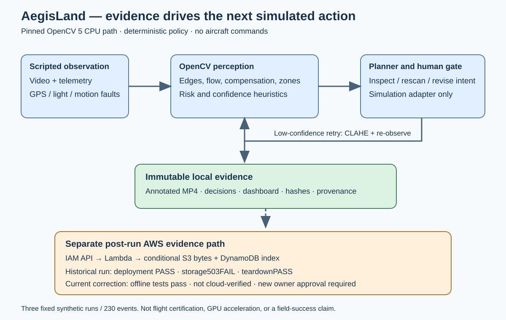

# AegisLand: visual evidence changes the next simulated action

Current judge-facing report, October 24, 2026. This supersedes status statements in the preserved earlier reports without changing their evidence.

## Problem and scope

A landing supervisor must reconsider a plan when a hazard appears, navigation becomes unavailable or visual confidence falls. AegisLand is a research tool for robotics developers inspecting that decision process. It links measured image changes to another observation, a revised simulated intent or a human-review state, with a trace explaining the transition.

The demonstration uses fixed synthetic imagery and telemetry. It sends no aircraft commands, does not simulate flight dynamics and does not establish production safety or real-world detection accuracy. Its intended operational benefit remains a hypothesis.

## Implementation and architecture

The external core is pinned to `eda23d3ea646e8943287703c07a91e9a3b2909fb`. It supplies perception, the deterministic agent/planner, policy, approval handling, scripted scenarios, command adapter and reporting. Competition additions provide the isolated launcher, provenance checks, post-run evidence protocol, cloud reliability tests and submission tooling. Core safety policy is unchanged. Coding agents assisted development; the runtime agent does not require an LLM.

Python 3.12, NumPy 2.5.2 and `opencv-python==5.0.0.93` provide the demonstrated environment; OpenCV imports as 5.0.0. OpenCV performs actual BGR/grayscale processing, blur, Canny/morphology, Laplacian texture analysis, Farneback optical flow, ORB/matching/homography compensation, candidate-zone measurements, CLAHE enhancement, annotation, video encoding and decoding. It is not merely imported for eligibility.

Low confidence can trigger enhancement and a second OpenCV observation when reserve permits. Perception feeds navigation/risk assessment and can change the next action. Human approval blocks execution where required; critical reserve can require emergency action without waiting. The unchanged deterministic policy—not a cloud response—makes these decisions.

The cloud path runs after local simulation: signed HTTP packets → IAM-authenticated API → Arm64 Lambda → conditional S3 object → DynamoDB index → verified acknowledgement. S3 bytes are read and hashed, then the index is conditionally inserted and consistently read. An acknowledgement identifies the bundle, sequence, canonical payload hash and object key. These checks are not an atomic cross-service transaction or a promise of permanent retention.

## Evaluation and observed behavior

The retained recordings are three scripted scenarios, not independent missions:

| Scenario | Events / decoded frames | Observed actions / behavior |
| --- | ---: | --- |
| Nominal | 60 | Continue mission throughout |
| Low battery and intrusion | 90 | Return40, evade25, land14, request-approval2, emergency-land9 |
| GPS loss and low light | 80 | Continue20, return2, request-approval51, land7; 50 active-perception frames |

At intrusion sequence 37, motion risk is 0 and intent is return-home; at 38, risk is 0.1825 and intent is evasive hold. At GPS/low-light 22 the trace shows pending human review; active perception changes from false at 29 to true at 30. This is evidence of a visual result changing later behavior and tool calls. It is not semantic person-detection evaluation. Approval-frame counts do not count distinct operator requests, and a confidence increase is not proof of improved hazard detection.

All230 events have matching decoded video and `hardware_command_sent=false`. Artifacts include annotated MP4, trace, summary, dashboard, OpenCV build details, commands and provenance hashes. A fresh 80-frame GPS/low-light run preserves all 80 decision dictionaries. The MP4's 15 FPS is playback speed, not throughput.

The current competition suite has 121 passing offline tests, including SDK contracts, malformed inputs, partial writes, permission/timeouts, concurrent identical/conflicting requests and strict acknowledgements. The full pinned core suite completed with 215 passed and one optional native-CUDA integration skipped, from 216 collected. The final validation matrix records the exact command/output separately from collection. Simulated invalid-signature/expired-time denials test client stop behavior; they do not prove live AWS authentication enforcement. One real unsigned request did return403 in the historical run.

CPU profiling separates uninstrumented, stage-instrumented and cProfile rounds and checks exact replay equivalence. Smoke measurements are from an uncontrolled host and are not advertised as real-time performance. Historical standalone CUDA summaries lack their full raw measurement artifacts here; no integrated GPU, COOL or speedup claim is made.

## Real AWS result and current correction

The reviewed stack's nine resources reached CREATE_COMPLETE. The deployed ZIP hash, Python 3.12 Arm64 configuration and AWS_IAM route were verified. The unsigned request returned the expected 403. The first signed packet returned **503 `storage_unverified`**. Verification stopped after two HTTP requests, with no retry and **zero successful storage acknowledgements**.

A 1,618-byte S3 packet matched its original bytes; no corresponding DynamoDB item existed. Evidence was exported before approved deletion of the stack, retained evidence bucket/table and exact staging object. The owner-managed staging bucket remains. Existing unrelated stack/template/function metadata was unchanged. This demonstrates a real deployment and failure boundary, not end-to-end cloud-storage success. Actual billed cost remains unavailable.

Saved logs retained only `ClientError`; the exact historical service, operation and AWS error code cannot be recovered. Offline investigation found an invalid bare `Sequence` expression, corrected with attribute-name aliases. A deterministic regression reproduces DynamoDB-style ValidationException and passes after the correction; this is not proof of the historical code. Additional hardening rejects numeric completion flags and wrong-type ACK sequences, handles deeply nested malformed JSON and adds sanitized diagnostics.

Candidate `final-hardening-20261023-r2` changes only storage/client module bytes; dependency hashes, the nine resources, scoped role/inline policy and encryption are unchanged. It has **not been verified in AWS**. Its conservative full-run allowance is $0.921067; two such allowances total $1.842134 against an aggregate $5 planning target. These are not actual bills or enforced caps. A second Phase A and subsequent new-UUID Phase B require separate authorization.

## Responsible use and reproduction

The synthetic inputs contain no bystander footage. Human-control limits, failure results and the simulation boundary are explicit. Private AWS identifiers/logs/configuration are excluded from the public package. Retained resources, delayed billing, shared concurrency and AWS-managed KMS are disclosed in the cloud plans. No quota increase, new security grant or safety-policy relaxation is part of the correction.

Follow [REPRODUCE.md](REPRODUCE.md), use the exact core pin and install the locked dependencies. Initial acquisition needs network; prepared execution is offline. The public source manifest identifies a working-tree snapshot rather than pretending the base commit contains uncommitted additions. Distribution rights, team eligibility, source/video access and a live-demo arrangement must be confirmed by the owner.

Primary evidence: `evidence/a1/final/`, `evidence/aws-phase-b/`, `evidence/storage-remediation/`, `evidence/hardening/` and the final validation matrix. The historical failure report remains `docs/AWS_PHASE_B_RESULT.md`. Claims about corrected live storage must remain pending until a separately authorized test verifies all packets and reconstructed files.
